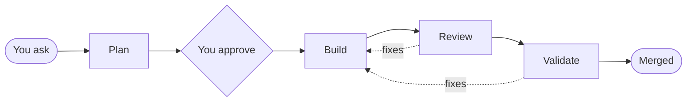

# ai-team

ai-team turns Claude Code into a small software team inside your project: one agent plans the work with you, others write the code, one reviews it and one tests the result the way a user would.

You ask in one line. The team comes back with a plan, asks only what you have to decide, and delivers the work reviewed, tested and merged into your branch.

```
/team add password reset by email
```

## Why a team

Ask a single session for a whole feature and the usual problems show up: code starts before the requirement is clear, the author reviews its own work, and you stay at the keyboard to keep it on track. ai-team splits the job the way a team does.

| Without a team | With ai-team |
|---|---|
| Code starts before the requirement is clear. | Your request becomes a written proposal, with the scenarios it has to pass. Nothing is coded before you approve it. |
| The author reviews its own work. | A reviewer that never touches the code reads the commits against the proposal and your standards. A validator then tests the scenarios through the screen or the API. |
| You watch every step. | The agents work in the background. What needs you arrives as a question with options and a recommended answer, in the terminal, the dashboard or your phone. |
| A long conversation loses the thread. | Each agent starts fresh with one job, and the state lives in files, so a change that stops halfway resumes where it was. |
| The agent does not know your project. | The installer reads your stack, branches, commands and docs and writes the agents for this project. |
| The same mistake comes back. | A mistake the reviewer catches in two changes becomes a lesson, loaded the next time an agent opens that code. |

## How a request flows



1. **You ask.** `/team <request>` in a Claude Code session.
2. **The team plans.** The spec-writer turns the request into a proposal: what changes, the scenarios it has to pass, the tasks. A decision only you can make (say, how long the reset link stays valid) comes as a question, with a recommended answer.
3. **You approve.** Nothing is coded before that.
4. **The team builds.** The builder (backend) and the integrator (frontend) write the code and its tests on a separate branch, in a git worktree, so your checkout stays free. Your project's own lint, tests and build have to pass.
5. **The team checks.** The reviewer sends back what blocks. The validator runs the scenarios as a user. What fails goes back to whoever wrote it.
6. **It lands.** The approved change is merged into your working branch and pushed, then archived with its spec, the record of what was built.

Not everything needs the full cycle. A targeted fix goes straight to a dev and the reviewer, and a question about the code is just answered. A full cycle runs several agents, so it costs more tokens than a single prompt: for a quick tweak, a regular `claude` session is still the right tool, and the team only steps in when you call it.

## The team

| Agent | Job |
|---|---|
| orchestrator | Talks to you, splits the work and calls the others. Never writes code. |
| spec-writer | Writes the proposal, the scenarios and the tasks, and brings you the open decisions. |
| provisioner | Keeps the local environment working: containers, scripts, `.env.example`. |
| builder | Backend: rules, persistence, migrations, tests. |
| integrator | Frontend: screens and their integration with the API. |
| reviewer | Reviews the commits against the proposal and your standards. Never fixes code. |
| validator | Tests the result against the scenarios, as a user. |

The installer creates the ones your project needs: an API-only project gets no integrator. They are plain Markdown files in `.claude/agents/`, committed with the project, so everyone who clones it gets the same team.

## Quick start

You need [Claude Code](https://claude.com/claude-code), git and Node 18+, on macOS or Linux ([full requirements](docs/configuration.md#requirements)).

```bash
cd my-project
curl -fsSL https://raw.githubusercontent.com/raphaelmonteiro/ai-team/main/install.sh | bash
```

The installer reads the project, writes what it found to `.claude/ai-team.conf` and generates the team from it. It recognizes Node, PHP, Python, Go, Rust, Ruby, JVM, .NET and Elixir projects, in a single package or a monorepo ([the full list](docs/configuration.md#what-the-detector-recognizes)).

It writes to `.claude/` and `.ai-team/`, adds a few lines to `.gitignore` and leaves your code alone. If the `openspec` CLI is missing, it installs it with `npm i -g` (`--no-openspec` skips it). To look first, add `-s -- --detect-only` after `bash` (prints what it understood, writes nothing) or `-s -- --dry-run` (shows what it would do).

Then, in a `claude` session:

```
/onboarding
```

Run it once per project: the team studies the code and records the context, standards, environment and architecture every agent reads from then on. After that, ask for work:

```
/team add password reset by email
```

## Follow the work

```bash
node .claude/ai-team/dashboard/server.mjs    # http://127.0.0.1:4321/
```

A local dashboard, with no dependencies beyond Node:

- **Board**: every change, its stage, who is working on it and what it is waiting for.
- **Decisions**: approve a proposal, answer the team's questions and allow or deny permission requests from the browser or, with [ntfy](https://ntfy.sh), from your phone.
- **Since you left**: a timeline of what happened while you were away.
- **Cost**: tokens and an estimate in dollars for every change and agent, with an optional budget.
- **Diff and documents**: what each change adds, and its proposal and reports rendered to read.
- **Hub**: several projects in one page, grouped by team.

## Make it fit your project

The installer gets the stack, the commands and the branches right in most projects. The rest is yours to set:

- **Language.** The agents reply and write in English by default. For Brazilian Portuguese, or any other language: `--set OUTPUT_LANGUAGE=pt-BR`.
- **Push.** By default the agents push what they integrate. With `--set GIT_NO_PUSH=1` they stop at your local branch and you push.
- **What the detector got wrong.** Edit `.claude/ai-team.conf` (branches, lint, test and build commands) and regenerate the team with `--render`.
- **What it cannot see.** Business rules, integrations and conventions go at the end of `.claude/project-context.md` and in your standards doc, which the reviewer uses as its yardstick.

```bash
curl -fsSL https://raw.githubusercontent.com/raphaelmonteiro/ai-team/main/install.sh | bash -s -- --render --set OUTPUT_LANGUAGE=pt-BR
```

## Documentation

- [Installing and configuring](docs/configuration.md): installer options, the conf, what gets installed, what the detector recognizes, requirements.
- [How the team works](docs/workflow.md): the cycle in detail, with the proposal critique, the worktrees, the review, the onboarding, the lessons and `/dream`.
- [Dashboard and hub](docs/dashboard.md): every panel, decisions, phone notifications, access from outside the machine, several projects in one hub.
- [Architecture](docs/architecture.md) and [standards](docs/standards.md): for working on ai-team itself (`make test` runs the tests).
