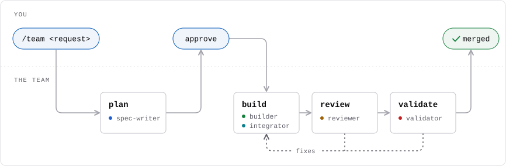

<p align="center">
  <picture>
    <source media="(prefers-color-scheme: dark)" srcset="docs/assets/mascot-dark.svg">
    <source media="(prefers-color-scheme: light)" srcset="docs/assets/mascot-light.svg">
    
  </picture>
</p>

<h1 align="center">ai-team</h1>

<p align="center">
  <b>A software team of Claude Code agents, inside your repo.</b><br>
  You ask in one line. It plans, builds, reviews and tests.
</p>

<p align="center">
  <a href="#how-it-works">How it works</a> ·
  <a href="#quick-start">Quick start</a> ·
  <a href="#the-team">The team</a> ·
  <a href="#documentation">Docs</a>
</p>

## How it works

ai-team turns Claude Code into a small software team inside your project: one agent plans the work with you, others write the code, one reviews it and one tests the result the way a user would.

<p align="center">
  <picture>
    <source media="(prefers-color-scheme: dark)" srcset="docs/assets/flow-dark.svg">
    <source media="(prefers-color-scheme: light)" srcset="docs/assets/flow-light.svg">
    
  </picture>
</p>

You act twice: you ask, and you approve the plan. No code is written before that, and what lands in your branch has passed your project's own lint, tests and build, and a review by an agent that did not write it.

A small fix skips the plan and goes straight to a dev and the reviewer. For a quick tweak, plain `claude` is still the right tool: the team only steps in when you call it.

## Quick start

```bash
cd my-project
curl -fsSL https://raw.githubusercontent.com/raphaelmonteiro/ai-team/main/install.sh | bash
```

Then, in a `claude` session:

| Command | What it does |
|---|---|
| `/onboarding` | Once: the team studies your project. |
| `/team add password reset by email` | Ask for work. |

Requires [Claude Code](https://claude.com/claude-code), git and Node 18+, on macOS or Linux. The installer writes to `.claude/` and `.ai-team/` and leaves your code alone; it installs the OpenSpec CLI with npm when it is missing. [Options and details](docs/configuration.md).

## What you get

- **A plan before code.** Your request becomes a proposal, with the scenarios it has to pass. You approve it first.
- **Independent review.** A reviewer that never touches the code, then a validator that tests like a user.
- **Questions, not babysitting.** The agents work in the background and ask only what you have to decide, with options, in the terminal, the dashboard or your phone.
- **Built for your project.** The installer reads your stack, branches, commands and docs, and writes the agents for it.
- **Your checkout stays free.** Each change lives in its own branch and git worktree.
- **A team that learns.** A mistake caught twice in review becomes a lesson, loaded the next time.

## The team

| Agent | Role |
|---|---|
| `orchestrator` | Talks to you and delegates. Never writes code. |
| `spec-writer` | Proposal, scenarios, tasks, and the decisions you need to make. |
| `provisioner` | Local environment: containers, scripts, `.env.example`. |
| `builder` | Backend: rules, persistence, migrations, tests. |
| `integrator` | Frontend: screens and API integration. |
| `reviewer` | Reviews the commits against the proposal and your standards. Never fixes code. |
| `validator` | Tests the result against the scenarios, as a user. |

Plain Markdown files in `.claude/agents/`, committed with your project. The installer creates the ones the project needs: an API-only project gets no integrator.

## Dashboard

```bash
node .claude/ai-team/dashboard/server.mjs    # http://127.0.0.1:4321
```

Every change and its stage, the decisions waiting for you (answer them from your phone), the cost of each change, and several projects in one hub. Local, with no dependencies beyond Node. [More](docs/dashboard.md).

## Documentation

| Guide | What is in it |
|---|---|
| [Install and configure](docs/configuration.md) | Options, the conf file, supported stacks, requirements |
| [How the team works](docs/workflow.md) | The cycle, decisions, review, onboarding |
| [Dashboard](docs/dashboard.md) | Decisions, phone notifications, remote access, the hub |

Working on ai-team itself: `make test`, [architecture](docs/architecture.md), [standards](docs/standards.md).
