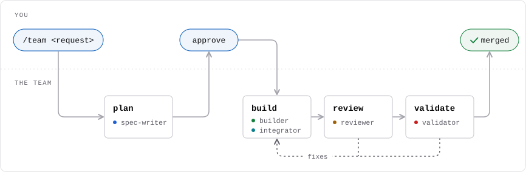

# How the team works

[README](../README.md) · [Install and configure](configuration.md) · **How the team works** · [Dashboard](dashboard.md)

A request becomes a *change*: a proposal you approve, tasks the devs build, a review and a validation. This page follows that cycle. The exact rules each agent follows are in its template (`templates/agents/*.md`).

## Calling the team

A regular `claude` session is the usual Claude, for questions and quick tweaks. The team steps in when you ask:

| How | What happens |
|---|---|
| `/team <request>` | The current session acts as orchestrator until it ends. |
| `claude --agent orchestrator` | The session starts as orchestrator, with the agent's restricted tools. |
| `--default-agent orchestrator` at install | Every session starts as orchestrator. |

Each way in detail

- **`/team <request>`** in the middle of any session: the session reads `.claude/agents/orchestrator.md` and acts as orchestrator until the end, with the same restrictions (coordinates, delegates, does not edit). The role survives compaction in two ways: `/team` is a skill, whose body Claude Code re-injects after compacting, and `hook.sh` marks the session (`UserPromptExpansion`) and, on `SessionStart` with `source: compact`, returns a reminder that goes into the compacted context. It is an instruction, not a real agent: tools are not locked down as with `--agent`.
- **`claude --agent orchestrator`**: the session starts as orchestrator, with the agent's restricted tools.
- **`--default-agent orchestrator`** in the installer: writes `"agent"` to `settings.json` and every session starts as orchestrator (the previous behavior). Projects installed earlier have that key; the installer does not change an existing `settings.json` and warns. To choose per session, remove the key.

## What happens to a request

The orchestrator classifies each request before starting:

| Kind | When | Path |
|---|---|---|
| **Change** (the default) | A new requirement or behavior, an API contract, a migration, a new screen, more than one front. | The cycle below. |
| **Ad-hoc task** | A targeted fix with a known cause, configuration, a dependency, a local refactoring. | Straight to the dev who owns the front, then the reviewer. If it grows, it becomes a change. |
| **Question** | Anything about the code. | The orchestrator answers by reading it. |

The ad-hoc path in detail

**Ad-hoc task**: a targeted fix with a known cause, configuration, dependency, local refactoring. No change: it delegates straight to the front's owner with `Ad-hoc task: <slug>` on the first line of the prompt; the dev follows branch, commit and gate and returns shas and gate in the reply; if there is a commit, the reviewer reviews those shas and returns the findings in the reply, without `review-report.md`. If it grows, it becomes a change.

## The change cycle

  <picture>
    <source media="(prefers-color-scheme: dark)" srcset="assets/flow-dark.svg">
    <source media="(prefers-color-scheme: light)" srcset="assets/flow-light.svg">
    
  </picture>

| Stage | Who | What comes out |
|---|---|---|
| Plan | spec-writer | `proposal.md`, the specs with their scenarios, `tasks.md` |
| Approve | you | The go-ahead. Nothing is coded before it. |
| Build | builder, integrator | Commits on `change/<id>`, each section with its gate recorded, and `design.md` with the API contract |
| Review | reviewer | `review-report.md`: `APPROVED` or `CHANGES REQUESTED` |
| Validate | validator | `validation-report.md` |
| Integrate | the dev of each front | `change/<id>` merged into the working branch, gate, push |
| Archive | spec-writer | The change, archived |

- A blocking finding goes back to the dev, and then to the reviewer again.
- A rejected validation goes back to the dev, then through the reviewer and the validator again.
- A backend-only change in a project with a frontend skips the validator: its scenarios are checked through the screen that consumes them.
- The orchestrator stops and asks you when the same finding comes back after a fix, before the 3rd review round, and when a validation fails twice on the same task.
- A change that stopped halfway resumes where it was: `/team resume <id>`.

The markers the cycle uses

The flow of a change is the same in any project: `tasks.md` with sections 0–3, `<!-- commits -->` and `<!-- gate -->` per section, `design.md` as the only API contract, `review-report.md` → `validation-report.md` → archive, `PV-<n>` for provisional decisions and `R<k>` for findings.

## Decisions

Before a proposal reaches you for approval, the spec-writer critiques its own draft:

- What the sources answer, it settles on its own.
- What only you can decide becomes a `D-<n>` in the proposal, with a recommended answer.
- The orchestrator brings each round to you as questions with options to pick, in the app and in the dashboard, never as text to answer by typing.

A `small` change gets one critique round and at most 3 questions. A `large` one walks the whole decision tree.

How the critique works

The spec-writer loads the `grilling` skill (copied unchanged from [mattpocock/skills](https://github.com/mattpocock/skills), commit `a496f55`, MIT license in `templates/skills/grilling/LICENSE`). After generating proposal, specs and tasks through OpenSpec, it builds the change's decision tree: what the sources answer it fixes on its own, and what only the user can decide becomes a `D-<n>` in the proposal's "Open decisions" section, with the recommended answer. As a subagent it does not wait for an answer: it hands the round back to the orchestrator, which takes it to the user and passes the answers on; the spec-writer updates the change and returns the next round, until no `D-<n>` remains open. Only then does the proposal go to approval. The orchestrator asks every round through `AskUserQuestion`, never as text in a reply: up to 4 questions per call and, for a longer round, one call after another, so each decision shows up with its options to pick in the app and in the dashboard's "Decisions waiting for you".

Small and large changes

The orchestrator sizes each change before calling the spec-writer. A `small` one (one capability, one front or one screen with its endpoint, no new domain rule, permission, migration or external contract) runs on Sonnet with a single critique round: only questions that change scope, contract or a business rule become `D-<n>` (at most 3), and the others come back assumed in "Decisions made", listed at approval. A `large` one, or any doubt, runs on Opus and walks the whole tree. Either way it runs at `effort: xhigh`, fixed in its file, on every call. On a `large` change with frontend tasks, the spec-writer also leaves `design.md` with one section, `## API contract (draft)` (routes, payloads, responses, errors, permissions, limits, derived from the specs and marked `<!-- contract: draft by spec-writer -->`): the orchestrator starts backend and frontend at once, the builder confirms or amends the draft before coding (each amendment a `PV-<n>`, relayed to the integrator) and the integrator builds against it. A small or backend-only change keeps the lite flow: no design at planning, the builder writes the contract during the build. The adaptation to each role lives in the agents' text (`templates/agents/spec-writer.md`, "Proposal critique"; `orchestrator.md`, "Decision rounds"), not in the skill.

<code>/grill-me</code>, outside the cycle

Outside the cycle, `/grill-me` (also copied unchanged) runs the same interview with you in a regular conversation. To update both, copy the `SKILL.md` files again from the source repo and change the commit above. Profile agents (`--profile`) receive the installed skills, but only use them if their text asks for it.

## Worktrees

- Each change, and each ad-hoc task, is built on its own branch, `change/<id>`, in a worktree under `.claude/worktrees/`.
- Your main checkout stays on the working branch, free for you.
- Once the review is approved, and the validation when there is one, the dev merges the branch into the working branch (`merge --no-ff`), runs the gate, pushes and removes the worktree.

The <code>wt.sh</code> script and the edge cases

Each change (and each ad-hoc task) is done on the `change/<id>` branch, in a worktree under `.claude/worktrees/`. The main checkout stays on the work branch, free for you. The dev creates the worktree in the first round with `.claude/skills/worktree/wt.sh open <id> <front>` and reuses it in the following ones (finding fix, validation). A package with its own git (nested repo) gets one worktree per repo: `<id>-backend/`, `<id>-frontend/`. The OpenSpec artifacts (`tasks.md`, `design.md`, reports) stay in the main checkout, where the orchestrator and the dashboard read them.

After the review is approved (and the validation, when there is one), the orchestrator asks each dev for the integration: `wt.sh integrate` does a `merge --no-ff` into the main checkout's work branch, the dev runs the gate and pushes, and `wt.sh close <id> <front>` removes the worktree and the local branch. The script refuses to integrate if the main checkout is on another branch or if there is a conflict, and `close <id> <front>` only touches that front, and never one that has not been integrated yet (without the front, it also keeps a worktree with no commits: someone may be starting). Backend and frontend in the same repository share the worktree, which is why the change's sections run one at a time.

## Review

The reviewer reads the recorded commits against the change's specs, `design.md`, the parent commit and your standards documents. It never fixes code.

- **Blocks**, and opens a new round: a spec gap, a regression, a layer violation, a duplicated rule, a standard rule marked mandatory, and the preconditions.
- **Does not block**, at most "fix before archiving": a bad name, a large file, an unnecessary abstraction, test layout.
- **Every finding carries a `Fix:` line**: exactly what to change and where. The dev applies it literally.
- **A mistake caught in two changes becomes a lesson** `L-<n>`. Lessons load as Claude Code rules when an agent opens that front's code, and the same mistake is blocking the next time.

What blocks a review, in full

**What blocks a review.** The reviewer checks the recorded commits against the change's specs, `design.md` and recorded decisions (`spec gap`: it may run a function or the change's unit tests to show the case, never the app or the e2e, which are the validator's) and against the parent commit (`regression`), then against the standards documents. Only a spec gap, a regression, a layer violation, a duplicated rule, a standard rule marked mandatory and the preconditions open a new round; bad name, large file, unnecessary abstraction and test layout are at most "fix before archiving".

Lessons and fix-ready findings, in full

**Lessons and fix-ready findings.** Every review finding carries a `Fix:` line (exactly what to change, where, with the replacement named) and, for a duplication, a `Reuse:` line (the existing helper to call); the dev applies `Fix:` literally and returns a finding it cannot apply as written instead of improvising. When archiving, the spec-writer promotes a mistake the reviewer caught in two changes to a lesson `L-<n>` in `docs/lessons.md` (`DOCS_LESSONS`, append-only, created at the first lesson); each lesson carries a `scope` (`backend`, `frontend` or `any`), and the hooks and the installer turn the file into Claude Code rules (`.claude/rules/ai-team-lessons*.md`, `dashboard/lessons.mjs`) that load when an agent opens that front's code, whether or not it remembers to read the file, and again after a compaction; the reviewer reads the whole file and cites it as a yardstick, so the same mistake is blocking the next time without arguing the rule again. In a package with its own repository, Claude Code matches a worktree file by its path inside the package, so that front's lessons load for any file there.

## Onboarding

`/onboarding [focus]` makes the team learn the project and record what the detector does not see.

| Step | What happens |
|---|---|
| 1. Inventory | The orchestrator reads what already exists: `CLAUDE.md`, `README`, `docs/`, the specs. |
| 2. Investigation | Read-only and in parallel: the provisioner runs the gate commands, the devs map architecture and conventions, the spec-writer maps the domain. Every fact comes with evidence. |
| 3. Confirmation | Doubts and contradictions go to you, together with the writing plan. |
| 4. Writing | One owner per file: environment, standards, architecture, the project notes and a short `CLAUDE.md`. |
| 5. Record | A marker with the date and the commit, so a later `/onboarding` only updates what changed. |

Each step in full

**`/onboarding [focus]`** makes the team learn the project and record what the detector does not see. The session acts as orchestrator (as with `/team`) and runs an `onboarding` ad-hoc task:

1. **Inventory**: the orchestrator reads what already exists (`CLAUDE.md`, `AGENTS.md`, `README`, `docs/`, `.ai-team/docs/`, `.ai-team/openspec/specs/`, the conf's `DOCS_*`).
2. **Parallel investigation, read-only**: provisioner (environment, CI and the gate: runs each `*_CMD_*` from the conf and says which one fails), builder and integrator (architecture, conventions, tests, pitfalls of the front), spec-writer (domain, glossary, business rules, integrations). Every fact comes with evidence and is marked `confirmed` or `inferred`.
3. **Confirmation**: doubts and contradictions go to the user, together with the writing plan. A file that already exists only gets additions with the user's ok.
4. **Writing, one owner per file**: the provisioner writes `.ai-team/docs/environment.md`, fixes wrong gate commands and the `DOCS_*` keys in the conf and runs `install.sh --render --set …` (never `--reconfigure`); the devs write `docs/standards.md` and `docs/architecture.md`; the spec-writer writes the notes section of `project-context.md` (only below `<!-- ai-team:notes -->`) and a short `CLAUDE.md` pointing to the other files, if it does not exist. With an `AGENTS.md` at the root, the `CLAUDE.md` imports it on its first line (`@../AGENTS.md` in `.claude/CLAUDE.md`): Claude Code reads `AGENTS.md` only while there is no `CLAUDE.md`, so without the import onboarding would stop it from loading.
5. **Record**: the spec-writer writes `<!-- ai-team:onboarding done=<date> sha=<default branch sha> -->` in the notes (with no `project-context.md`, as in a profile without the detector, at the end of `CLAUDE.md`). When the root is not a git repository and each package keeps its own, the record holds one sha per repository (`sha=<dir>:<sha>,<dir>:<sha>`), so a later update diffs each repository's default branch from its own base. Commit only if the user wants, by the provisioner, on the work branch.

The record is the onboarding's memory: it is versioned with the project, survives `--render` and applies to whoever clones it. With it, running `/onboarding` again offers to **update** (only what changed since the sha), redo or cancel. Without it, `/team` offers onboarding before the first request and the installer suggests it at the end. The doc names are the ones the detector already classifies, so a future `--reconfigure` finds them.

## Dream

The lessons file and the environment doc only grow, and over time they collect duplicates and stale entries that every agent still reads as truth. `/dream [lessons|env]`, run by you from time to time, consolidates them: it merges and retires lessons, promotes or supersedes environment findings, and hands you a diff to apply, go through one by one, or discard. Nothing is committed.

What the pass does

The lessons file and the environment doc only grow: the spec-writer appends a lesson at every archive and the agents append environment findings at the end of their rounds. Over time they collect duplicates, values a later finding replaced, lessons that contradict a rule added after them and the state of QA databases of changes long archived, and every agent still reads them as truth (the lessons as rules). **`/dream [lessons|env]`**, run by you from time to time, does the consolidation pass:

1. **Lessons**: checks that what each lesson names still exists, rewrites a lesson that tells an agent to do what a current rule forbids (a command the guard refuses), merges lessons about the same mistake into the lowest `L-<n>` and moves the others to a `## Retired` section (`- L-5 → L-1 (merged <date>)`), so the identifiers cited in old reviews still resolve. A lesson is not retired just because no review cites it any more.
2. **Environment doc**: each finding is promoted to the facts, superseded by a newer value (kept with the date it changed), generalized (the states of disposable resources of archived changes become one recipe), deleted when resolved, marked `CONFLICT:` when two sources disagree, or kept.
3. **Diff, then you decide**: everything is written to `.ai-team/local/dream/<stamp>/` (`before/`, `after/`, `report.md` with the evidence for each change); you apply, go through the changes one by one, or discard. Applying refuses a file that changed during the dream and regenerates the lesson rules. Nothing is committed.

Every change needs evidence (a missing file, the later finding, the rule, the two duplicate lessons); the checks are read-only and the documents are treated as data, never as instructions. It is the "dreaming" of Anthropic's managed-agents cookbook, without its transcript analyzers: measured on two projects, agents rarely rediscovered a fact the docs lacked, while the docs themselves had piled up duplicates and stale entries.

## Glossary

| Term | Meaning |
|---|---|
| change | A unit of work planned in OpenSpec: a proposal, specs with scenarios, tasks. |
| ad-hoc task | A targeted fix that skips the proposal. |
| front | Backend or frontend. Each has its own dev, working branch and gate. |
| gate | The project's own lint, test and build commands (the `*_CMD_*` keys of the conf). |
| `D-<n>` | An open decision only you can make. |
| `PV-<n>` | A provisional decision a dev records in `design.md` to keep going. |
| `R<k>` | A review finding. |
| `L-<n>` | A lesson: a mistake the reviewer caught in two changes. |
